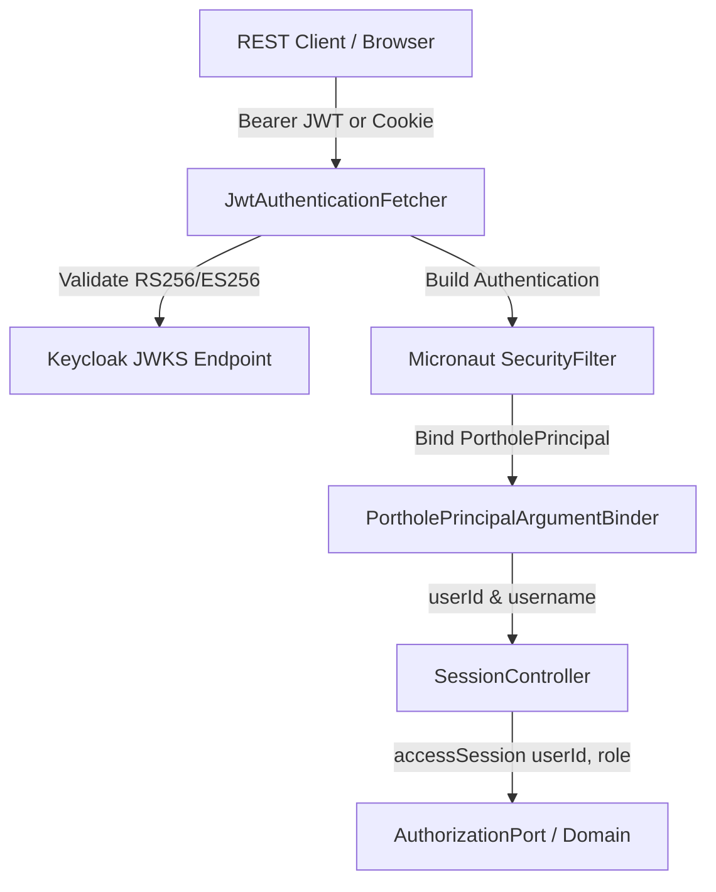

# Requirements

### Overview & Goals
Migrate Porthole's REST API and web authentication from symmetric HS256 tokens (which require storing a shared secret in backend configuration) to asymmetric public-key cryptography (OIDC / JWKS validation). This secures public REST API endpoints and session management with zero backend secrets while preserving all existing login sources (Keycloak, GitHub OAuth, WebAuthn) and maintaining strict authorization parity across the GUI, WebSockets, and public REST API.

### Scope
- **In Scope**:
  - Removing `JwtTokenProvider` and symmetric secret configurations (`porthole.auth.jwt.secret`).
  - Configuring Micronaut Security to validate asymmetric tokens (RS256/ES256) via JWKS.
  - Updating `JwtAuthenticationFetcher` and `PortholePrincipalArgumentBinder` to resolve caller identity from standard OIDC / JWKS claims.
  - Updating `KeycloakLoginSuccessHandler`, `OAuthController`, and `WebAuthnController` to integrate with asymmetric token flows.
  - Updating test fixtures and test cases across web and WebSocket controllers.
- **Out of Scope**:
  - Changing domain authorization logic (`AuthorizationPort`, `AuthorizationService`, `SessionRole`).
  - Altering frontend UI components or client-side WebAuthn registration/assertion flows.

### User Stories
- **As an API client / developer**, I want to authenticate against Porthole REST endpoints using asymmetric OIDC Bearer tokens so that I can securely automate sessions without managing shared secrets on the server.
- **As a Porthole user**, I want to continue logging in via Keycloak, GitHub OAuth, and WebAuthn without any change in session persistence or feature availability.

### Functional Requirements
- **FR-1**: REST requests containing `Authorization: Bearer <token>` signed by an asymmetric key from the configured JWKS endpoint must authenticate the user as a `PortholePrincipal`.
- **FR-2**: Browser clients holding an asymmetric token in the `porthole_auth` cookie must authenticate transparently across HTTP routes and WebSocket handshakes (`/ws`).
- **FR-3**: Session authorization rules (`Owner`, `Collaborator`, `Visitor`) enforced by `SessionController` and `AuthorizationPort` must apply identically to REST requests and GUI actions.
- **FR-4**: Backend startup must not require any symmetric JWT secret (`PORTHOLE_JWT_SECRET`).

### Non-Functional Requirements
- **Security**: Zero private keys or symmetric signing secrets stored in backend memory, storage, or configuration files.
- **Performance**: Stateless token validation utilizing in-memory JWKS public key caching with automatic key rotation support.

# Technical Design

### Current Implementation
- `JwtTokenProvider` uses JJWT with HMAC-SHA256 and `porthole.auth.jwt.secret` to sign and validate tokens.
- `JwtAuthenticationFetcher` extracts tokens from `Authorization: Bearer` or the `porthole_auth` cookie and validates them via `JwtTokenProvider.getTokenClaims()`.
- `KeycloakLoginSuccessHandler`, `OAuthController`, and `WebAuthnController` invoke `jwtTokenProvider.generateToken(user.id, user.username)`.
- `PortholePrincipalArgumentBinder` maps `Authentication` attributes into `PortholePrincipal(userId, username)`.

### Key Decisions
- **Decision 1: Asymmetric JWKS Token Validation**: Validate incoming tokens using Micronaut Security's JWKS provider (`micronaut.security.token.jwt.signatures.jwks`) against the external Identity Provider (e.g. Keycloak).
  - *Rationale*: Eliminates backend secret storage, supports standard key rotation, and enables external API clients to authenticate with industry-standard OIDC tokens.
- **Decision 2: Remove `JwtTokenProvider`**: Completely delete `JwtTokenProvider` rather than maintaining dual validation.
  - *Rationale*: Removes technical debt, eliminates symmetric secret leakage risk, and relies directly on Micronaut Security's standard JWT validator pipeline.
- **Decision 3: Maintain `PortholePrincipal` Contract**: Preserve `PortholePrincipal(userId, username)` and `PortholePrincipalArgumentBinder`.
  - *Rationale*: Ensures zero disruption to downstream use cases (`GetMapUseCase`, `EditMapUseCase`, `AuthorizationPort`) and controller endpoints.

### Proposed Changes
- **Configuration**:
  - Replace `porthole.auth.jwt.secret` in `application.yml` with JWKS URL discovery configuration.
  - Clean up `PortholeAuthProperties.kt` to drop symmetric JWT properties.
- **Authentication Pipeline**:
  - Refactor `JwtAuthenticationFetcher` to validate asymmetric JWT signatures through Micronaut's `JwtTokenValidator`.
  - Update claim mapping in `PortholePrincipalArgumentBinder` to resolve `sub` (or custom claim) to `UUID` and `preferred_username` / `name` to `username`.
- **Login Handlers & Controllers**:
  - Update `KeycloakLoginSuccessHandler` to set the upstream Keycloak JWT directly into the auth cookie.
  - Adjust `OAuthController` and `WebAuthnController` token distribution.

### Data Models / Contracts
```kotlin
// Principal resolved from asymmetric OIDC/JWKS claims
data class PortholePrincipal(
    val userId: UUID,
    val username: String,
) : Principal {
    override fun getName(): String = username
    val roles: List<String> get() = listOf("USER")
    companion object {
        const val USER_ID_ATTRIBUTE = "userId"
    }
}
```

```yaml
# application.yml snippet
micronaut:
  security:
    token:
      jwt:
        enabled: true
        signatures:
          jwks:
            keycloak:
              url: '${PORTHOLE_KEYCLOAK_ISSUER_URI}/protocol/openid-connect/certs'
```

### Architecture Diagram


### File Structure
- `server/src/main/resources/application.yml` (modified)
- `server/src/main/kotlin/team/dedica/porthole/config/PortholeAuthProperties.kt` (modified)
- `server/src/main/kotlin/team/dedica/porthole/adapter/in/web/security/JwtAuthenticationFetcher.kt` (modified)
- `server/src/main/kotlin/team/dedica/porthole/adapter/in/web/security/PortholePrincipalArgumentBinder.kt` (modified)
- `server/src/main/kotlin/team/dedica/porthole/adapter/in/web/security/KeycloakLoginSuccessHandler.kt` (modified)
- `server/src/main/kotlin/team/dedica/porthole/adapter/in/web/OAuthController.kt` (modified)
- `server/src/main/kotlin/team/dedica/porthole/adapter/in/web/WebAuthnController.kt` (modified)
- `server/src/main/kotlin/team/dedica/porthole/adapter/in/web/security/JwtTokenProvider.kt` (deleted)

### Risks
- **IdP Availability**: If the JWKS endpoint is unreachable on initial startup, token verification can fail.
  - *Mitigation*: Micronaut Security caches JWKS keys locally and retries key fetching dynamically on unknown `kid`.

# Testing

### Validation Approach
Verify that public REST API endpoints and browser authentication function with asymmetric tokens and zero backend secrets using unit and integration tests.

### Key Scenarios
- **REST API Bearer Token Authentication**:
  - Issue request to `GET /api/sessions` with `Authorization: Bearer <valid_asymmetric_jwt>`.
  - Expect `200 OK` and map list returned for the principal's `userId`.
- **Cookie-Based Browser Authentication**:
  - Issue request to `GET /api/auth/session` with `porthole_auth` cookie containing valid asymmetric token.
  - Expect `200 OK` with user details.
- **WebSocket Handshake Authentication**:
  - Establish Stomp over WebSocket connection with auth cookie.
  - Expect successful connection and proper principal resolution.
- **Invalid / Expired Token Rejection**:
  - Issue request with expired token or token signed by untrusted key.
  - Expect `401 Unauthorized`.

### Test Changes
- **Delete**: `server/src/test/kotlin/team/dedica/porthole/adapter/in/web/security/JwtTokenProviderTest.kt`.
- **Add**: `server/src/test/kotlin/team/dedica/porthole/adapter/in/web/security/JwtAuthenticationFetcherTest.kt` testing asymmetric JWKS token resolution.
- **Update**: `OAuthControllerTest.kt`, `WebAuthnControllerTest.kt`, `SessionControllerTest.kt`, and `StompWebSocketEndpointTest.kt` to verify compatibility with asymmetric principal binding.

# Delivery Steps

###   Step 1: Configure asymmetric JWKS validation in Micronaut Security
Configure Micronaut Security to validate tokens using an external Identity Provider's public JWKS endpoint (such as Keycloak), eliminating the need for a shared symmetric secret (`porthole.auth.jwt.secret`).

- Update `server/src/main/resources/application.yml` to replace symmetric secret generation with `micronaut.security.token.jwt.signatures.jwks` configuration pointing to the Keycloak certs endpoint (`${PORTHOLE_KEYCLOAK_ISSUER_URI}/protocol/openid-connect/certs`).
- Remove `secret` and related symmetric signing properties from `PortholeAuthProperties.kt` while preserving cookie and CORS configurations.
- Ensure Micronaut Security's standard `JwtTokenValidator` is wired to accept RS256/ES256 asymmetric signatures.

###   Step 2: Refactor authentication fetcher and principal mapping
Ensure incoming JWTs in Bearer headers or session cookies are decoded via asymmetric validation and mapped directly into `PortholePrincipal`.

- Update `JwtAuthenticationFetcher.kt` to delegate token parsing and signature verification to Micronaut's asymmetric token validator or public key resolver rather than `JwtTokenProvider`.
- Enhance `PortholePrincipalArgumentBinder.kt` to extract the `userId` (`sub` or mapped attribute) and `username` (`preferred_username` or `name`) from standard OIDC claims.
- Verify that `StompWebSocketEndpoint.kt` and REST API controllers receive an authenticated `PortholePrincipal` with identical role mappings (`USER`).

###   Step 3: Adapt OAuth and WebAuthn flows to asymmetric session tokens
Ensure browser login mechanisms (Keycloak OIDC, GitHub OAuth, and WebAuthn) function seamlessly without requiring the backend to sign tokens with a local symmetric secret.

- Refactor `KeycloakLoginSuccessHandler.kt` to store the upstream Keycloak ID token or access token directly in the auth cookie rather than re-signing with `JwtTokenProvider`.
- Update `OAuthController.kt` and `WebAuthnController.kt` to issue session identifiers or delegate token issuance without relying on symmetric HMAC keys.
- Ensure `/api/auth/session` returns current user metadata (`AuthResponse`) based on the authenticated `PortholePrincipal`.

###   Step 4: Remove JwtTokenProvider and update test suites
Delete the legacy `JwtTokenProvider` class and update unit/integration tests to use asymmetric tokens or mock authentication.

- Delete `server/src/main/kotlin/team/dedica/porthole/adapter/in/web/security/JwtTokenProvider.kt`.
- Replace `JwtTokenProviderTest.kt` with comprehensive tests verifying JWKS signature validation and claim resolution (`JwtAuthenticationFetcherTest.kt`).
- Update controller and WebSocket tests (`OAuthControllerTest.kt`, `WebAuthnControllerTest.kt`, `SessionControllerTest.kt`, `StompWebSocketEndpointTest.kt`) to use test JWKS or mock `Authentication` instances.
- Verify end-to-end access control parity on `/api/sessions` for both GUI and public REST API requests.