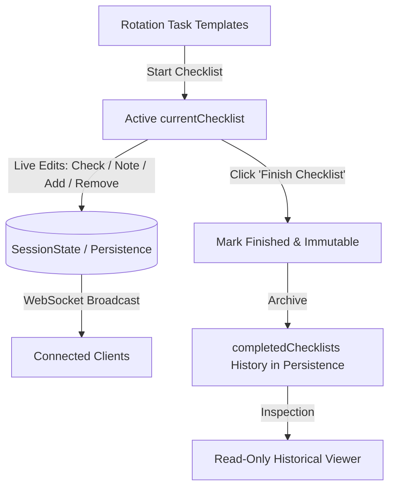

# Requirements

### Overview & Goals
Enhance greenkeeping rotations so that each rotation manages its operational checklists directly within server persistence rather than relying on browser file downloads. Each rotation has template tasks from which a **current checklist** is instantiated. Team members can collaboratively edit, check off tasks, and add notes to the active checklist. When duties are completed, the checklist is marked as **finished**, making it permanently immutable and archived in persistence, allowing a fresh checklist to be started for the next rotation cycle.

### Scope
- **In Scope:**
  - Persisting rotation checklist state on the server (integrated into `GreenkeepingRotation` session state).
  - Instantiating a `currentChecklist` from the rotation's task templates on demand (defaulting title to current date `YYYY-MM-DD`).
  - Real-time updates and synchronization across collaborators for active checklist modifications (toggling tasks, updating notes, adding/removing tasks).
  - Explicit "Finish Checklist" action that marks the current checklist as complete, records the completion timestamp and author, locks it from further modifications (immutability), and moves it to the rotation's completed checklist history.
  - Viewing past immutable checklists for historical operational audits.
  - Ability to start a new checklist once the current one is finished or if none exists.
- **Out of Scope:**
  - Browser-local file export / File System Access API as the primary persistence mechanism.
  - Granular operational checklist rollback (finished checklists are strictly immutable).

### User Stories
- **As a greenkeeper on duty**, I want to start today's checklist from the rotation template so that all required tasks are initialized in server state with today's date.
- **As a team collaborator**, I want to check off tasks and record operational notes in real time so that teammates see current progress immediately.
- **As a greenkeeper completing my shift**, I want to finish the checklist so that it is permanently saved to persistence, marked immutable, and archived in the rotation's history.
- **As a team lead or auditor**, I want to browse past finished checklists for a rotation to inspect when duties were performed and what notes were logged.

### Functional Requirements
- **Checklist Lifecycle & State:**
  - Each `GreenkeepingRotation` holds at most one `currentChecklist` (active / in progress) and a list of `completedChecklists` (historical / immutable).
  - Starting a checklist clones the rotation's `taskTemplates` into items with `done: false`, empty notes, and title defaulting to the current date (`YYYY-MM-DD`).
- **Active Checklist Editing:**
  - While a checklist is current (not finished), any collaborator can:
    - Toggle `done` status on individual tasks.
    - Edit task titles and add/edit optional execution notes.
    - Add ad-hoc tasks or delete non-relevant tasks.
    - Edit the overall checklist title.
  - Updates are saved to server session state and broadcast via WebSocket to all connected clients.
- **Finishing & Immutability:**
  - Clicking "Finish Checklist" transitions the current checklist to completed status, sets `finishedAt` (timestamp) and `finishedBy` (collaborator ID/username), and archives it into `completedChecklists`.
  - Once finished, the checklist is strictly read-only and immutable. Backend use cases reject edit attempts on finished checklists.
  - After finishing, the rotation's `currentChecklist` is cleared (or null), enabling a new checklist to be started when the next cycle begins.
- **History & Inspection:**
  - The rotation view / checklist dialog allows users to view the active checklist or inspect previous completed checklists in read-only mode.

### Non-Functional Requirements
- **Data Integrity & Immutability:** Finished checklists cannot be mutated or overwritten by subsequent edits.
- **Real-time Collaboration:** Checklist updates propagate instantly to other connected clients via WebSocket broadcasts.
- **Hexagonal Architecture & Persistence:** Follow existing backend port/use-case architecture and JSON session state persistence.

# Technical Design

### Current Implementation
- `GreenkeepingRotation.kt` contains rotation metadata, collaborators, and `taskTemplates: MutableList<GreenkeepingTaskTemplateItem>`.
- `SessionState.kt` stores `greenkeepingRotations: MutableMap<UUID, GreenkeepingRotation>`.
- `GreenkeepingRotationsView.tsx` and `GreenkeepingTasklistDialog.tsx` currently handle local template instantiation and JSON export.
- Real-time updates use `MapStateBroadcaster.sendGreenkeepingRotations` over `/topic/map/{sessionId}/greenkeeping-rotations`.

### Key Decisions
- **Persist checklists directly within `GreenkeepingRotation`:**
  - Adding `currentChecklist: GreenkeepingChecklist?` and `completedChecklists: MutableList<GreenkeepingChecklist>` to `GreenkeepingRotation`.
  - This ensures all checklist updates leverage existing session persistence (`SessionStatePort`), automatic JSON serialization, and WebSocket broadcasting without requiring separate database tables or orphaned state.
- **Server-enforced Immutability:**
  - Finishing a checklist sets `finishedAt = Instant.now()` and `finishedBy = callerId`, moves it from `currentChecklist` to `completedChecklists`, and resets `currentChecklist = null`.
  - Any mutation endpoint requires an active `currentChecklist`; completed checklists in `completedChecklists` have no update endpoints.
- **Granular Checklist Operations vs. Unified Rotation Updates:**
  - Provide dedicated use cases and REST endpoints for checklist lifecycle:
    - `POST /api/sessions/{id}/greenkeeping-rotations/{rotationId}/checklist` (start new checklist)
    - `PUT /api/sessions/{id}/greenkeeping-rotations/{rotationId}/checklist` (update active checklist items/title)
    - `POST /api/sessions/{id}/greenkeeping-rotations/{rotationId}/checklist/finish` (finish active checklist)
    - `DELETE /api/sessions/{id}/greenkeeping-rotations/{rotationId}/checklist` (discard active in-progress checklist if started in error)

### Data Models / Contracts

#### Backend Kotlin Domain Models (`server/src/main/kotlin/team/dedica/porthole/domain/`)
```kotlin
data class GreenkeepingChecklistItem(
    val id: UUID = UUID.randomUUID(),
    var title: String,
    var done: Boolean = false,
    var note: String? = null,
)

data class GreenkeepingChecklist(
    val id: UUID = UUID.randomUUID(),
    var title: String,
    val createdAt: Instant = Instant.now(),
    val createdBy: UUID? = null,
    var finishedAt: Instant? = null,
    var finishedBy: UUID? = null,
    val items: MutableList<GreenkeepingChecklistItem> = mutableListOf(),
)

data class GreenkeepingRotation(
    val id: UUID = UUID.randomUUID(),
    var name: String,
    var description: String? = null,
    var link: String? = null,
    val groupIds: MutableList<UUID> = mutableListOf(),
    val collaborators: MutableList<GreenkeepingRotationCollaborator> = mutableListOf(),
    val taskTemplates: MutableList<GreenkeepingTaskTemplateItem> = mutableListOf(),
    var currentChecklist: GreenkeepingChecklist? = null,
    val completedChecklists: MutableList<GreenkeepingChecklist> = mutableListOf(),
    var updatedAt: Instant = Instant.now(),
    var updatedBy: UUID? = null,
)
```

#### TypeScript Types (`client/src/types/greenkeeping.ts`)
```typescript
export interface GreenkeepingChecklistItem {
  id: string;
  title: string;
  done: boolean;
  note?: string | null;
}

export interface GreenkeepingChecklist {
  id: string;
  title: string;
  createdAt: string;
  createdBy?: string | null;
  finishedAt?: string | null;
  finishedBy?: string | null;
  items: GreenkeepingChecklistItem[];
}

export interface GreenkeepingRotation {
  id: string;
  name: string;
  description?: string | null;
  link?: string | null;
  groupIds: string[];
  collaborators: GreenkeepingRotationCollaborator[];
  taskTemplates: GreenkeepingTaskTemplateItem[];
  currentChecklist?: GreenkeepingChecklist | null;
  completedChecklists?: GreenkeepingChecklist[];
  updatedAt?: string;
  updatedBy?: string | null;
}
```

### Architecture Diagram


### Risks
- **Concurrent edits on active checklist:** Collaborators editing simultaneously could overwrite each other's item notes. *Mitigation:* Broadcast updated rotation state on every mutation and preserve client focus / optimistic updates cleanly.
- **Accidental checklist completion:** User might click "Finish" prematurely. *Mitigation:* Require a confirmation prompt in the UI before finalizing and locking the checklist.

# Testing

### Validation Approach
Automated testing with Kotlin unit/integration tests for checklist use cases and REST endpoints, together with Vitest/React Testing Library tests for the interactive checklist UI, immutability locking, and history view.

### Key Scenarios
- **Start Checklist:**
  - Call start checklist endpoint on a rotation with template tasks. Verify `currentChecklist` is created with current date title, all template tasks initialized (`done: false`), and state persisted and broadcast.
  - Attempting to start a checklist when `currentChecklist` is already active returns a conflict error or opens the existing active checklist.
- **Update Active Checklist:**
  - Toggle item `done`, update task title, add/edit notes, add new task item, delete task item. Verify updates persist in `currentChecklist`.
- **Finish Checklist (Immutability):**
  - Call finish checklist endpoint. Verify `finishedAt` and `finishedBy` are populated, checklist is moved to `completedChecklists`, and `currentChecklist` is set to `null`.
  - Verify that subsequent update requests targeted at the finished checklist are rejected.
- **UI Checklist Dialog Flow:**
  - Verify active checklist allows toggling checkboxes and editing notes with immediate save.
  - Verify clicking "Finish Checklist" locks the form, updates status, and transitions dialog to completed view.
  - Verify history tab/dropdown renders past completed checklists in read-only mode with completion details.

### Test Changes
- `server/src/test/kotlin/team/dedica/porthole/application/StartGreenkeepingChecklistUseCaseTest.kt` (New)
- `server/src/test/kotlin/team/dedica/porthole/application/UpdateGreenkeepingChecklistUseCaseTest.kt` (New)
- `server/src/test/kotlin/team/dedica/porthole/application/FinishGreenkeepingChecklistUseCaseTest.kt` (New)
- `client/src/test/GreenkeepingTasklistDialog.test.tsx`: Update to test server-persisted active checklist interactions, finish action, and immutable history inspection.

# Delivery Steps

### ✓ Step 1: Implement backend checklist domain models, persistence, and use cases
The backend supports persistent active and completed checklists on greenkeeping rotations with lifecycle operations and immutability enforcement.

- Create `GreenkeepingChecklist` and `GreenkeepingChecklistItem` domain entities and add `currentChecklist` and `completedChecklists` to `GreenkeepingRotation.kt`.
- Create DTOs (`GreenkeepingChecklistResponse`, `UpdateGreenkeepingChecklistRequest`, `StartGreenkeepingChecklistRequest`) in `MapRequestDtos.kt` and `MapResponseDtos.kt`.
- Implement `StartGreenkeepingChecklistUseCase`, `UpdateGreenkeepingChecklistUseCase`, and `FinishGreenkeepingChecklistUseCase` under `server/src/main/kotlin/team/dedica/porthole/application/session/greenkeeping/`.
- Add REST endpoints to `GreenkeepingRotationController.kt` and ensure changes trigger `BroadcastPort.sendGreenkeepingRotations`.
- Add unit tests verifying starting, editing, finishing, and immutability constraints.

### ✓ Step 2: Update frontend API client, types, and store synchronization
The frontend client communicates with checklist REST endpoints and handles real-time rotation checklist state.

- Update `client/src/types/greenkeeping.ts` with `GreenkeepingChecklist`, `GreenkeepingChecklistItem`, and updated rotation payload types.
- Add API functions in `client/src/api/mapApi.ts` (`startGreenkeepingChecklist`, `updateGreenkeepingChecklist`, `finishGreenkeepingChecklist`).
- Update `mapStore.ts` and WebSocket handlers to seamlessly update rotations with their `currentChecklist` and `completedChecklists`.

### ✓ Step 3: Implement persistent checklist runner, completion flow, and history viewer in UI
Users can start, interactively edit, finish, and view immutable historical checklists directly in the application.

- Update `client/src/components/GreenkeepingRotationsView/GreenkeepingRotationsView.tsx` to indicate active checklist status on rotation cards and open the checklist runner.
- Refactor `client/src/components/GreenkeepingRotationsView/GreenkeepingTasklistDialog.tsx` to bind to server state instead of local file export.
- Add interactive checklist controls with auto-save / debounced update, "Finish Checklist" button with confirmation, and read-only mode for completed checklists.
- Add a history view/selector allowing users to inspect previous immutable checklists with timestamps and completion metadata.
- Update frontend tests in `client/src/test/GreenkeepingTasklistDialog.test.tsx` and `client/src/test/GreenkeepingRotationsView.test.tsx`.