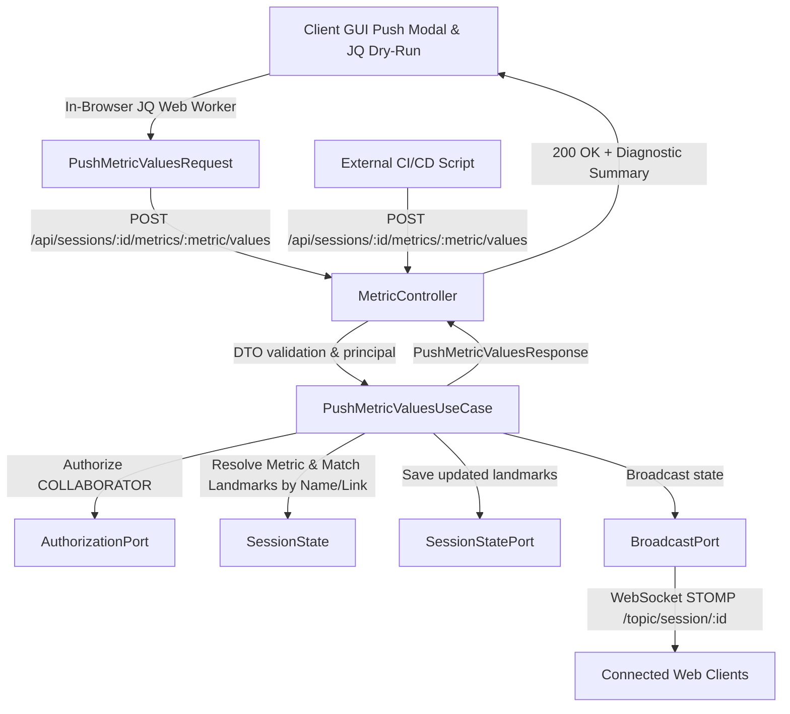

# Requirements

### Overview & Goals
Provide a public REST API endpoint and an in-client JSON REST request builder that allows users and external automation (e.g. CI/CD pipelines, GitLab bots) to push quality metric values into an existing session without needing internal landmark UUIDs. Landmarks will be matched by human-readable identifiers such as landmark/repository names or external resource links (e.g. repository URLs).

### Scope
- **In Scope**:
  - Server-side batch endpoint `POST /api/sessions/{id}/metrics/{metricIdentifier}/values` accepting metric UUID or metric name.
  - Flexible landmark resolution strategy (matching by landmark name or external resource links with optional key-targeting and canonical URL normalization).
  - Migration of `Landmark` entity from a single `link` property to a `links` key-value map (`Map<String, String>`) across backend domain, persistence, use cases, and frontend components, with backwards-compatible deserialization for legacy sessions.
  - Validation and sanitation of values, links, and badge URLs matching existing rules in `SetLandmarkMetricUseCase`.
  - Real-time WebSocket broadcasting of updated session states.
  - Interactive client-side modal (`MetricPushRequestModal.tsx`) with dynamic URL generation, template payload generation, cURL snippet generation, and live execution.
  - In-browser `jq` transformation engine (WebAssembly/worker-isolated) allowing users to map arbitrary external JSON payloads (e.g. from GitLab, GitHub, SonarQube) into the batch push schema.
  - Reusable transformation presets (storing foreign query URL, HTTP method, `jq` filter expression, last payload sample, and matching strategy) persisted with session metrics.
  - Interactive dry-run reconciliation in the GUI comparing transformed payloads against active map landmarks before submission.
  - Full GUI integration routing batch metric pushes through the new `POST /api/sessions/{id}/metrics/{metricIdentifier}/values` endpoint.
- **Out of Scope**:
  - Automatically creating new landmarks if no name or link match is found (unmatched elements are reported back in the response).
  - Matching by hex coordinates or internal database IDs.

### User Stories
- **As a user / CI integration**, I want to push metric values (such as open merge requests by repository from GitLab) into a session for an existing metric without needing internal element UUIDs, matching elements by repository / landmark name or repository URLs.
- **As a session collaborator**, I want an interactive REST request editor in the UI that builds the exact API path using the session ID and metric ID (or name) and generates valid sample payloads with one-click cURL export so that I can easily configure CI integrations.
- **As a session collaborator**, I want to define and test `jq` transformations directly in the browser against external API responses with a live dry-run preview, and save reusable transformation presets so that our team can repeatably import external data or export ready-to-run automation scripts.
- **As a user interacting with the GUI**, I want all batch metric push operations in the frontend to execute via the new server batch endpoint `POST /api/sessions/{id}/metrics/{metricIdentifier}/values` for unified, consistent validation and real-time broadcasting.

### Functional Requirements
- **FR-1**: The backend must expose `POST /api/sessions/{id}/metrics/{metricIdentifier}/values`, where `{metricIdentifier}` can be either a metric UUID or a metric name (case-insensitive lookup).
- **FR-2**: The request body must allow specifying a matching strategy: `NAME` (case-insensitive) OR `LINK` (canonical URL matching against landmark links with optional `matchKey`).
- **FR-3**: If a landmark matches the target `element`, its metric value, quality level, description, link, and badges must be updated or added according to `DataSanitationUtils` validation.
- **FR-4**: The response must return `200 OK` with summary metadata (`updatedCount`, `unmatchedElements`, `warnings`).
- **FR-5**: The client UI must provide a "REST API / Push Values" action in `MetricsView` and `MetricsPanel` opening a dialog supporting both direct JSON payload editing and in-browser `jq` transformation dry-runs.
- **FR-6**: The modal must support saving, loading, and managing reusable transformation presets (foreign request URL, HTTP method, `jq` filter expression, last payload sample, and matching configuration) associated with the metric definition.
- **FR-7**: The modal must execute `jq` transformations client-side in a Web Worker (WebAssembly-based `jq`) with a strict execution timeout and provide an interactive dry-run table comparing transformed data against active map landmarks before submission.
- **FR-8**: The GUI (both direct JSON push and preset execution) must submit batch updates directly to `POST /api/sessions/{id}/metrics/{metricIdentifier}/values`, giving live diagnostic feedback.

### Non-Functional Requirements
- **Security**: Requires standard JWT / session authentication with `COLLABORATOR` or `ADMIN` role.
- **Performance**: Single-pass indexing of landmarks for $O(N + M)$ batch update complexity instead of repeated scans.
- **Usability**: Clear diagnostic messages when elements fail to match, aiding script debugging.


# Technical Design

### Current Implementation
- `MetricController.kt` handles CRUD operations for quality metrics definitions (`/api/sessions/{id}/metrics`).
- `LandmarkMetricController.kt` handles setting metric values for individual landmarks via `PUT /api/sessions/{id}/landmarks/{landmarkId}/metrics/{metricId}`.
- `SetLandmarkMetricUseCase.kt` validates input (links, badges, quality levels) and updates `Landmark.metrics[metricId]`.
- `MetricsView.tsx` and `MetricsPanel.tsx` provide manual table/cell editing for individual landmark metric values.

### Key Decisions
- **Decision 1: Endpoint Identifier Flexibility**: Allow `{metricIdentifier}` to match either a metric UUID or a URL-encoded metric name (case-insensitive).
  - *Rationale*: Eliminates the prerequisite step of querying metric UUIDs before sending updates from external scripts.
- **Decision 2: Landmark Matching Strategies (NAME and LINK)**: Support resolution by `NAME` (trimmed, case-insensitive) and `LINK` (canonical URL matching). For link matching, if `matchKey` is provided (e.g. `"gitlab"`), match against `landmark.links[matchKey]`; if omitted, match against any link URL in `landmark.links.values`.
  - *Rationale*: External systems like GitLab, GitHub, or SonarQube identify targets either by repository name or repository URLs. Canonical URL normalization (ignoring protocol variations, trailing `.git`, and trailing slashes) ensures robust matching.
- **Decision 3: Landmark Multi-Link Migration & Backwards Compatibility**: Migrate `Landmark.link: String?` to `Landmark.links: Map<String, String>` (key-value pairs such as `"repository"`, `"docs"`, `"dashboard"`), while maintaining backwards compatibility via Jackson alias/fallback deserialization for legacy sessions with a single `link` field.
  - *Rationale*: Landmarks frequently have multiple associated external resources (repository, dashboard, docs), enabling targeted link matching without ambiguity.
- **Decision 4: Non-Blocking Partial Updates with Diagnostics**: If some elements in the batch do not match any landmark, apply updates to all matched elements and return unmatched elements in `unmatchedElements` list rather than failing the entire transaction.
  - *Rationale*: Maximizes data ingestion throughput in CI pipelines while giving actionable diagnostics for misspelled names or missing links.
- **Decision 5: Client-Side JQ Transformation & Worker Sandboxing**: Execute user-defined `jq` expressions entirely in-browser using WebAssembly (`jq-web` / `jq-wasm`) inside a dedicated Web Worker with a strict evaluation timeout (500 ms).
  - *Rationale*: Maximizes utility and zero-risk compute isolation. Protects backend resources from DoS or unbounded CPU loops while providing instantaneous live feedback and zero server-side transformation overhead.
- **Decision 6: Reusable Transformation Preset Persistence**: Attach reusable transformation configurations (request URL, method, `jq` filter expression, last payload sample, match options) to metric definitions in session state without persisting user auth tokens or credentials.
  - *Rationale*: Reduces repetitive configuration effort, allows multi-user inspection of integrations, and enables 1-click CI/CD script synthesis (curl + jq + batch push).
- **Decision 7: Unified Batch Endpoint for GUI and Automation**: Unify client GUI updates with external automation by routing all batch metric push operations in the frontend through `POST /api/sessions/{id}/metrics/{metricIdentifier}/values`.
  - *Rationale*: Ensures consistent validation, sanitation, matching logic, and WebSocket state broadcasts across both interactive UI workflows and automated pipelines.

### Proposed Changes
- **Backend**:
  - Migrate `Landmark.link: String?` to `Landmark.links: Map<String, String>` in `team.dedica.porthole.domain.Landmark` and update `EditLandmarkUseCase` & persistence.
  - Add `MetricTransformationPreset` domain entity and include `presets: List<MetricTransformationPreset>` in `QualityMetric`.
  - Add `PushMetricValuesUseCase` in `team.dedica.porthole.application.session.metrics`.
  - Add `POST /api/sessions/{id}/metrics/{metricIdentifier}/values` in `MetricController.kt`.
  - Implement DTOs in `team.dedica.porthole.adapter.in.web.dto`: `PushMetricValuesRequest`, `MetricElementValueDto`, `PushMetricValuesResponse`, `MetricTransformationPresetDto`, and `MatchStrategy`.
  - Implement canonical URL normalization utility in `DataSanitationUtils`.
- **Frontend**:
  - Update `Landmark` interface and UI editors (`LandmarkPanel.tsx`, `LandmarkInfoPopover.tsx`) to support key-value `links`.
  - Integrate in-browser `jq` evaluation worker (`client/src/services/jqWorker.ts`) with timeout protection.
  - Create `MetricPushRequestModal.tsx` in `client/src/components/MetricsView/` with tabs for Direct JSON and JQ Transformation Builder with dry-run preview table.
  - Add transformation preset persistence controls (save, load, update, export automation script).
  - Add open trigger in `MetricsView.tsx` toolbar and `MetricsPanel.tsx`.
  - Add helper function in `client/src/services/metricService.ts` for batch metric push targeting `POST /api/sessions/{id}/metrics/{metricIdentifier}/values`.

### Data Models / Contracts
```kotlin
enum class MatchStrategy {
    NAME,
    LINK
}

data class MetricElementValueDto(
    @field:NotBlank
    val element: String,
    val value: String? = null,
    val level: QualityLevel = QualityLevel.INFO,
    val description: String? = null,
    val link: String? = null,
    val linkText: String? = null,
    val badges: Map<String, String> = emptyMap()
)

data class PushMetricValuesRequest(
    val matchBy: MatchStrategy = MatchStrategy.NAME,
    val matchKey: String? = null,
    val values: List<MetricElementValueDto> = emptyList()
)

data class PushMetricValuesResponse(
    val updatedCount: Int,
    val unmatchedElements: List<String> = emptyList(),
    val warnings: List<String> = emptyList()
)

data class MetricTransformationPreset(
    val id: UUID = UUID.randomUUID(),
    val name: String,
    val metricId: UUID,
    val requestUrl: String,
    val httpMethod: String = "GET",
    val jqFilter: String,
    val matchBy: MatchStrategy = MatchStrategy.NAME,
    val matchKey: String? = null,
    val lastPayloadSample: String? = null,
    val updatedAt: Instant = Instant.now()
)

data class QualityMetric(
    val id: UUID,
    val name: String,
    val description: String,
    val link: String? = null,
    val presets: List<MetricTransformationPreset> = emptyList()
)

// Updated domain model
data class Landmark(
    val id: UUID,
    val name: String = id.toString(),
    val ownerId: UUID? = null,
    val coordinate: HexCoordinate? = null,
    val type: LandmarkType = LandmarkType.KEEP,
    val description: String? = null,
    val groupId: UUID? = null,
    val links: Map<String, String> = emptyMap(),
    val metrics: Map<UUID, LandmarkMetricEntry> = emptyMap()
)
```

### Architecture Diagram


### File Structure
- `server/src/main/kotlin/team/dedica/porthole/domain/Landmark.kt` (modified: `link` -> `links: Map<String, String>`)
- `../../server/src/main/kotlin/team/dedica/porthole/domain/MetricTransformation.kt` (added)
- `server/src/main/kotlin/team/dedica/porthole/adapter/in/web/dto/MetricValuePushDto.kt` (added)
- `server/src/main/kotlin/team/dedica/porthole/application/session/metrics/PushMetricValuesUseCase.kt` (added)
- `server/src/main/kotlin/team/dedica/porthole/adapter/in/web/MetricController.kt` (modified)
- `client/src/types/landmark.ts` (modified: `links: Record<string, string>`, `MetricTransformationPreset`)
- `client/src/services/jqWorker.ts` (added: Web Worker for sandboxed jq execution)
- `client/src/components/MetricsView/MetricPushRequestModal.tsx` (added: modal with Direct JSON & JQ Transformation Builder tabs)
- `client/src/components/MetricsView/MetricDryRunPreview.tsx` (added: dry-run diff table against landmarks)
- `client/src/components/MetricsView/MetricsView.tsx` (modified: toolbar trigger and batch push routing)
- `client/src/components/Sidebar/panels/MetricsPanel.tsx` (modified: panel action trigger)
- `client/src/components/Sidebar/panels/LandmarkPanel.tsx` (modified: multi-link editor)

### Risks
- **Duplicate Landmark Names or Links**: Multiple landmarks may share the same name or link URL on a map.
  - *Mitigation*: Update all landmarks matching the given name or link and include an informational warning in the response.
- **URL Sanitation and Validation**: External scripts may supply malformed badge URLs or links.
  - *Mitigation*: Reuse `cleanLink` and canonical URI normalization to validate and standardize URLs before matching and persistence.
- **Backwards Compatibility of Session Data**: Existing saved sessions contain single `link: String?` in landmarks.
  - *Mitigation*: Support JSON deserialization fallback mapping legacy `link` strings into `links = mapOf("default" to link)` or `"repository"`.


# Testing

### Validation Approach
Automated backend unit/integration tests and client UI testing will verify that external REST calls correctly update metrics using element names and links, and that the client-side request builder and multi-link landmark editor function as expected.

### Key Scenarios
- **Batch Push by Exact & Case-Insensitive Landmark Name**:
  - Send POST request with repository/landmark names matching existing landmarks.
  - Verify that matching landmarks have their `metrics` map updated with new value, level, link, and badges.
  - Verify `200 OK` response with `updatedCount` matching number of updated landmarks.
- **Batch Push by Landmark Link (Global & Keyed)**:
  - Send POST request with `matchBy: LINK` matching canonical URLs against `landmark.links.values` or `landmark.links[matchKey]`.
  - Verify protocol/trailing-slash/git-suffix variations still match correctly.
- **Batch Push by Metric Name vs UUID**:
  - Send POST request using metric name in URL (e.g. `POST /api/sessions/{id}/metrics/Open%20Merge%20Requests/values`).
  - Verify metric is correctly resolved and applied.
- **Unmatched Elements Handling**:
  - Send payload containing names or links that do not exist on the map.
  - Verify matched elements are updated while unmatched elements are reported in `unmatchedElements`.
- **Authorization & Security**:
  - Verify unauthenticated or read-only (`VIEWER`) requests receive `401 Unauthorized` or `403 Forbidden`.
- **In-Browser JQ Transformation & Dry-Run Reconciliation**:
  - Provide arbitrary foreign JSON (e.g., GitLab API response) and execute in-browser `jq` filter in a Web Worker.
  - Verify live dry-run table matches output elements against active map landmarks with zero server calls.
- **Transformation Preset Persistence & Export**:
  - Save foreign request URL, `jq` filter, payload sample, and match strategy on a metric.
  - Verify preset is retained across sessions and exports executable CI/CD shell scripts.
- **Client REST Request Modal & Multi-Link UI**:
  - Verify sample JSON is generated using actual landmarks and links from the active map.
  - Verify cURL copy functionality produces valid syntax with current session ID and metric ID.
  - Verify Landmark panel and popover can add, edit, and display key-value link pairs.
- **GUI Execution via New Batch Endpoint**:
  - Verify all GUI-triggered metric push operations post to `POST /api/sessions/{id}/metrics/{metricIdentifier}/values` and receive live feedback.

### Test Changes
- **Add**: `server/src/test/kotlin/team/dedica/porthole/application/session/metrics/PushMetricValuesUseCaseTest.kt`
- **Add**: `server/src/test/kotlin/team/dedica/porthole/adapter/in/web/MetricControllerPushValuesTest.kt`
- **Add**: `client/src/components/MetricsView/__tests__/MetricPushRequestModal.test.tsx`
- **Add**: `client/src/services/__tests__/jqWorker.test.ts`
- **Update**: existing backend and frontend tests expecting `landmark.link` to use `landmark.links`.


# Delivery Steps

### Step 1: Migrate Landmark links structure and implement batch metric use case with matching strategies
The backend domain layer supports multi-link landmarks and matching landmarks by name or link URL to update metric values in batch.

- Update `Landmark` domain entity and DTOs to replace single `link: String?` with `links: Map<String, String>` with backwards-compatible deserialization.
- Update `EditLandmarkUseCase` and relevant controllers/persistence to handle `links`.
- Create `PushMetricValuesUseCase` in `team.dedica.porthole.application.session.metrics`.
- Implement metric resolution supporting both UUID and case-insensitive metric name matching against `sessionState.metrics`.
- Implement landmark matching by `NAME` (trimmed, case-insensitive) and `LINK` (canonical URL matching against `links.values` or `links[matchKey]`).
- Apply `DataSanitationUtils.cleanLink` and badge URL validation to incoming payload items.
- Update `Landmark.metrics` map for matched landmarks, persist updated state via `SessionStatePort`, and broadcast changes via `BroadcastPort.send(sessionId, state)`.
- Collect and return statistics: updated landmark count, unmatched element identifiers, and non-fatal warnings.

### Step 2: Expose batch metric push REST endpoint, DTOs, and preset persistence
The backend exposes a secure REST API endpoint for pushing metric updates and supports persisting reusable metric transformation presets.

- Define request and response DTOs (`PushMetricValuesRequest`, `MetricElementValueDto`, `PushMetricValuesResponse`, `MetricTransformationPresetDto`, `MatchStrategy`) in `team.dedica.porthole.adapter.in.web.dto`.
- Add `POST /api/sessions/{id}/metrics/{metricIdentifier}/values` endpoint to `MetricController.kt`.
- Attach `MetricTransformationPreset` list to `QualityMetric` domain model and metric update operations.
- Require `COLLABORATOR` or `ADMIN` role access via standard `PortholePrincipal` authentication.
- Implement comprehensive error handling for missing session (`404`), missing metric (`404`), and invalid payload data (`400`).
- Add unit and integration tests covering successful updates, name-based resolution, link-based resolution, unmatched element handling, and permission boundaries.

### Step 3: Implement client landmark multi-links, in-browser JQ worker, and dry-run engine
Update landmark UI for multi-links and build client-side transformation facilities.

- Update `Landmark` TypeScript definitions (`links?: Record<string, string>`) and UI components (`LandmarkPanel.tsx`, `LandmarkInfoPopover.tsx`) to display and manage key-value link pairs.
- Implement in-browser Web Worker (`jqWorker.ts`) running `jq` WebAssembly with execution timeouts for client sandboxing.
- Build `MetricDryRunPreview.tsx` to reconcile transformed DTO elements against active session landmarks before dispatching requests.
- Provide payload sample generators and preset storage management in `metricService.ts`.

### Step 4: Integrate REST request builder and transformation tabs in GUI with batch endpoint execution
Users can configure payloads or jq transformations in the UI, test via dry-run preview, and execute updates directly against the batch endpoint.

- Create `MetricPushRequestModal.tsx` in `client/src/components/MetricsView/` with tabs for Direct JSON editing and JQ Transformation Builder.
- Add an "API / Push Values" button to metric action bars in `MetricsView.tsx` and `MetricsPanel.tsx`.
- Connect GUI "Push Values" and "Run Transformation" actions directly to `POST /api/sessions/{id}/metrics/{metricIdentifier}/values` via `metricService.ts`.
- Provide one-click synthesis and copying of ready-to-run automation snippets (foreign API curl + jq filter + batch push curl).
- Display live response feedback including updated element count, unmatched elements alerts, and validation errors.
- Ensure state updates broadcast over WebSocket synchronize immediately across client views without requiring manual page refresh.