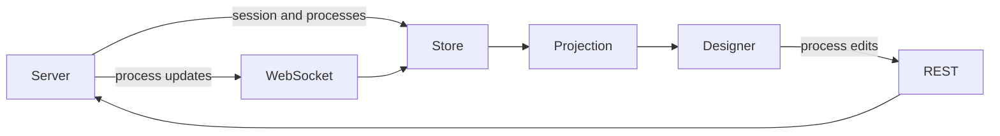

# Requirements

### Overview
Add a session navigation entry for a dedicated process list and designer, preserving the existing X-Ray map and its route.

### Design workflow
- List existing processes with name and description; create, open, edit and delete processes with confirmation.
- Open a shareable subpage for an existing process or create a new one and continue into its designer.
- Show a geometry-free directed graph: landmarks are nodes and existing map connections are edges. Stages are ordered and selectable; show their assigned edges, labels and direction, including repeated connections across stages.
- Provide clear controls to add, rename, reorder and delete stages; add existing connections to a stage using a searchable picker; edit title and direction or remove an assignment. Edits save through existing APIs; deleting an assignment must not delete the map connection.
- Explain empty states and when no eligible map connections exist; handle loading, errors, permission failures and deleted processes. Offer keyboard-accessible controls and a non-graph list of stage connections.
- Graph layout is automatic and independent of map coordinates; no free-standing nodes, map editing, or persisted manual layout.

# Technical Design

### Current implementation
`App.tsx` routes `/session/:id/processes` to `ProcessMapView`; `Navbar.tsx` uses that route for X-Ray. `ProcessPanel.tsx` and `mapApi.ts` implement process and stage operations against `ProcessController`; `ProcessStage` contains `StageConnection` references to map `Connection` objects. `useSessionWebSocket.ts` hydrates processes but has no process subscription.

### Approach
- Keep `/session/:id/processes` unchanged; add `/session/:id/process-design` and `/session/:id/process-design/:processId` under `MapPage`, with distinct desktop/mobile navigation and nested-route active matching.
- Resolve stage assignments through `currentMap.connections` and their landmark endpoints. Render an automatically laid-out React/SVG diagram with arrows and labels, stage filtering, and a parallel accessible connection list; layout is presentation-only and handles cycles, self-links, parallel edges and missing references gracefully. Avoid introducing a graph dependency unless necessary.
- Reuse `useMapStore`, existing REST functions and authorization; keep routes as selection source of truth and handle duplicate process names by identifying a newly created ID from the before/after ID sets rather than name. If the result is ambiguous, return to the list rather than opening the wrong process.
- Publish the authoritative process list after successful mutations using the existing `BroadcastPort`/`MapStateBroadcaster` pattern and subscribe in `useSessionWebSocket.ts`; hydrate on reconnect. Keep local form drafts intact when remote updates arrive and surface conflicts/deletions rather than silently discarding input. Preserve current session access controls for REST and websocket topics.

### File structure
- Modify `client/src/App.tsx`, `client/src/components/Navbar/Navbar.tsx`, `client/src/hooks/useSessionWebSocket.ts` and relevant store code.
- Add `client/src/pages/ProcessDesign/` for the list, designer and graph projection/layout helpers.
- Extend `server/src/main/kotlin/team/dedica/porthole/application/session/processes/`, `application/port/BroadcastPort.kt` and `adapter/out/messaging/MapStateBroadcaster.kt` for process broadcasts; follow existing topic authorization conventions.
- Add focused client and server tests alongside existing process and navigation tests.

### Data flow

### Risks
Existing process APIs return complete lists rather than created IDs; concurrent creation makes identification ambiguous. Concurrent edits remain server-authoritative, without introducing versioned conflict resolution; alert users when incoming data affects an open draft.

# Testing

### Validation
- Add Vitest coverage for navigation, deep links, creation, deletion, stage and connection editing, loading and failures; run `npm test` and `npm run build` in `client`.
- Test graph projection for directions, shared connections, multiple stages, cycles, missing references and empty data, plus accessible list interactions.
- Add server tests for authorization, successful broadcasts and failed mutations; verify two clients receive process changes and reconnect hydration, and existing X-Ray behavior remains intact.

# Delivery Steps

###   Step 1: Add process list and navigation
Users can navigate to a process list and open or create a process without losing X-Ray.
- Add protected session routes and distinct desktop/mobile navigation in `App.tsx` and `Navbar.tsx`.
- Implement the list, creation, metadata editing, deletion confirmation and deep-link handling using existing APIs and store.
- Cover routing, loading, failures and duplicate-name creation in client tests.

###   Step 2: Build abstract process designer
Users can design ordered process stages through an abstract, map-independent graph.
- Project existing landmarks, connections and stage assignments into an automatically laid-out React/SVG diagram with an accessible connection list.
- Add stage management and a searchable existing-connection picker with title and direction editing.
- Handle empty, missing and deleted data and test graph and editing edge cases.

###   Step 3: Synchronize process edits across clients
Saved process changes propagate to other session clients in real time.
- Extend the existing broadcast port and messaging adapter and publish after successful process mutations.
- Subscribe and rehydrate in `useSessionWebSocket.ts`, preserving drafts and surfacing conflicting updates.
- Test authorization, broadcasts, reconnect behavior and X-Ray regressions.